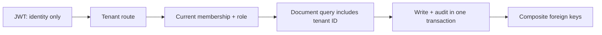

# Tenant access at the API boundary

[](https://github.com/aistrategyc/tenant-access-lab/actions/workflows/ci.yml)

Knowing a document ID must not grant access to it. Neither should a token issued
before a user was removed from a workspace.

This small **FastAPI + PostgreSQL** service has two synthetic organizations, three
roles, documents and notes. It demonstrates application-level tenant isolation,
live membership checks, composite foreign keys and concurrent editing.

The design problem comes from SaaS and document-workflow work in
[Planerix and LEG](https://github.com/aistrategyc/aistrategyc/blob/main/cases/biuro.md).
This is independent example code, not a client system or an identity provider.



## Try the boundary

Requires Docker Compose and [uv](https://docs.astral.sh/uv/getting-started/installation/).

```sh
git clone https://github.com/aistrategyc/tenant-access-lab.git
cd tenant-access-lab
cp .env.example .env
set -a; . ./.env; set +a
docker compose up -d --wait
uv sync --locked
uv run lab demo
uv run pytest
```

The demo reads Alice's Blue workspace document (`200`), tries the Red document
through both workspace URLs (`404`), and attempts a write as a viewer (`403`).

For an interactive API:

```sh
uv run lab seed
uv run lab token --user alice
uv run uvicorn tenant_lab.api:from_env --factory --host 127.0.0.1 --port 8001
```

The token command is a local developer tool. There is no public login or
self-registration endpoint. Pass the token in `Authorization: Bearer …`.
The contract is visible at `http://127.0.0.1:8001/docs`.

## Access rules

| Action | Viewer | Editor | Admin |
|---|---|---|---|
| List / read own workspace documents | Yes | Yes | Yes |
| Create / update / add notes | No | Yes | Yes |
| Read another workspace without membership | No | No | No |
| Manage memberships through this API | Not exposed | Not exposed | Not exposed |

Admin and editor have the same document permissions in this example. Membership
administration belongs to a separate control plane.

The JWT supplies `sub`, issuer, audience and expiry. Role claims are ignored.
Membership is read from PostgreSQL on each request and held stable until the
transaction finishes. Revoking access therefore applies to subsequent requests,
even if their token has not expired.

## Engineering details

- Every document lookup uses `(tenant_id, document_id)`.
- Child records carry the tenant ID; a composite foreign key rejects a note
  linked to another organization's document.
- Request bodies cannot set tenant or actor. The route and authenticated identity
  supply those fields.
- Updates carry `expected_version`. Two concurrent edits of version 1 produce
  one success and one conflict, rather than silently overwriting each other.
- Business changes and audit events commit together. An audit write failure
  rolls back the document update.
- Lists use bounded keyset pagination.

[API](src/tenant_lab/api.py) · [Access checks](src/tenant_lab/access.py) ·
[Schema](src/tenant_lab/sql/001_initial.sql) · [Tests](tests/test_access.py)

## What the tests try to break

Cross-tenant reads and writes, foreign child references, forged and expired
tokens, changed roles, revoked membership, identity fields in request bodies,
concurrent edits and failed audit writes. An additional lock test shows that a
revocation cannot commit halfway through an already authorized transaction.

**This is not PostgreSQL RLS.** A privileged SQL connection can bypass the
application query rules. The [design notes](docs/design.md) explain that trade-off,
the revocation boundary and what would need to change before production use.

By [Kyrylo Prolieiev](https://github.com/aistrategyc) · [Engineering portfolio](https://proleev.com/en) · MIT
