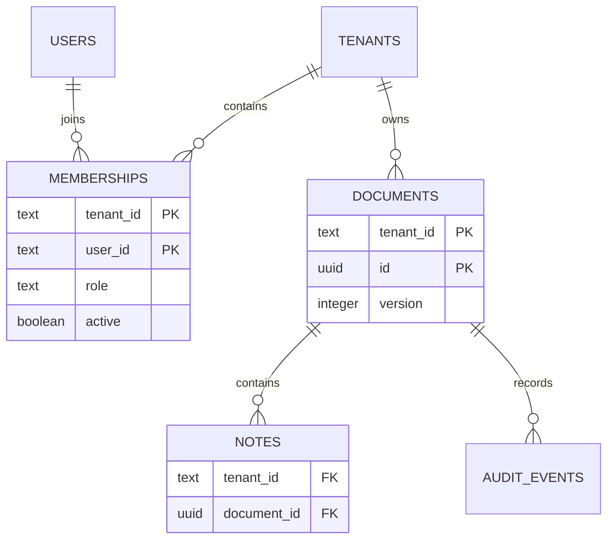

# Identity, membership and record scope

These are three different questions:

1. Who signed this request? The JWT verifier establishes the subject.
2. May this subject work in this tenant now? The membership row answers this.
3. Does the requested record belong to that tenant? The record query answers this.

Putting a tenant ID in a token or filtering a React screen does not answer all
three. The tests call the API directly and use real document IDs.

## Revocation has a transaction boundary

The membership query uses `FOR SHARE`. A request keeps that row lock through
its document operation. A concurrent role change or revocation must wait.
If revocation commits first, the request sees the new state and fails.

This gives an understandable order without keeping a membership cache. It does
not cancel a response already sent or remove data a user previously downloaded.
Request transactions should stay short; no external network calls occur inside
them.

## Why application isolation here?

It makes the checks visible in a small API example and keeps the local database
setup simple. The cost is discipline: every new query must preserve tenant scope.
Composite foreign keys stop invalid relationships but do not filter reads.

RLS would add a second enforcement layer. It also requires a non-bypass runtime
role, transaction-local tenant context, safe pool reuse and tests using that role.
Adding policies while testing with a superuser would not demonstrate that layer.
Those pieces are intentionally absent, so this repository does not claim RLS.

## HTTP behaviour

Missing or invalid authentication returns `401`. An authenticated outsider sees
the same `404` for a missing workspace and an inaccessible record. A current
viewer attempting a write gets `403`. A stale document version gets `409`.

This keeps the API contract clear but is not a claim of constant-time responses.
Rate limiting and traffic analysis need deployment-level treatment.

## Deliberate limits

HS256 tokens are issued by a local CLI. A deployed product needs its own OIDC
integration, signing-key rotation, account lifecycle and session policy.
There is no MFA, tenant provisioning API, row-level encryption or audit retention
service. The database role used by the demo can modify audit rows; they are
transactional records, not an immutable compliance log.

[Operating notes](operations.md)
